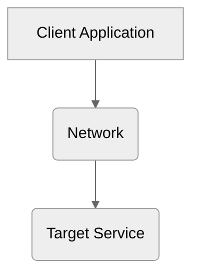
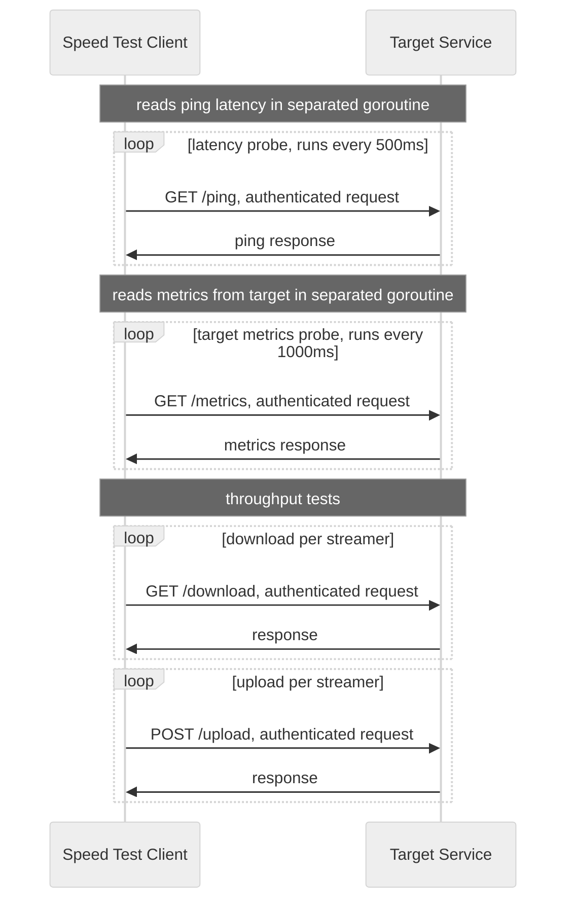

# Speed Test

Speed Test tools diagnostikují síťovou komunikaci. Měří latency, propustnost a další diagnostické informace síťové
komunikace.

Projekt se skládá ze dvou nezávislých služeb. Služba `target` vystavuje REST API pro vytvoření zátěže na síti.
Aplikace `client` spouští zátěžové testy a shromažduje diagnostická data.

## Architecture



### Target service

Služba `target` vystavuje REST API endpointy pro vytvoření zátěže na síti a endpointy pro diagnostiku. Všechny endpointy
jsou za autentizačním middleware, který kontroluje hlavičku `X-Api-Key` oproti nakonfigurovanému klíči přes
environmentální proměnnou `API_KEY`. Porovnání klíčů bylo kvůli co největší efektivitě při zachování bezpečnosti
realizováno pomocí funkce `subtle.ConstantTimeCompare`, u které nelze na základě času odvodit správnost klíče.

V aplikaci je inicializována goroutine, která sbírá aktuální metriky procesoru a paměti, které lze na vyžádání
poskytnout přes REST API.

Služba běží v docker containeru.

**API**:

- `GET /ping` - implementován jako jednoduchý handler vracející 204 (no content).
- `GET /metrics` - poskytuje informace o stavu procesoru a paměti ve formátu JSON
  ```json
    {
      "cpu": {
        "usage": 0.07940446650124067
      },
      "memory": {
        "allocMB": 2.0848236083984375,
        "goroutines": 9
      }
    }
  ```
- `GET /download` - poskytuje nekonečný stream dat
- `POST /upload` - konzumuje stream dat a zahazuje je (discard); po přijetí všech dat odpovídá o velikosti přijatých dat
  ```json
    {
      "receivedBytes": 524
    }
  ```

### Client application

CLI aplikace `client` inicializuje diagnostické testy proti službě `target`.

Aplikaci lze parametrizovat následujícími vlastnostmi při spuštění:

- `download-phase-duration` - doba v sekundách, kdy se provádí stahování dat ze služby `target`
- `upload-phase-duration`  - doba v sekundách, kdy se provádí nahrávání dat do služby `target`
- `streams` - počet paralelních goroutines provádející fázi stahování a následně fázi nahrávání
- `target` - URL cílové služby

Služba běží jednorázově v docker containeru a výsledky vypisuje na standardní výstup.

**Popis chování:**

- po spuštění jednorázového docker kontejneru se inicializuje aplikace
- proběhne `ping` request na službu `target`, pokud neprojde, aplikace se zastaví
- aplikace inicializuje sběr statistik z testů a sond a vypisuje je na standardní výstup pomocí ANSI esc znaků
- spustí se goroutine na měření latence
    - aplikace posílá každých 500ms `ping` request proti službe `target`
    - nabírá kromě poslední hodnoty i průběžné měření, z kterých se počítají statistiky
- spustí se goroutine na vyčítání metrik ze služby `target`, jako je využití CPU, paměti a podobně
- spustí se goroutine na samotný zátěžový test
    - test se skládá ze dvou fází; fáze stahování dat a fáze odesílání dat
    - podle nastaveného parametru `streams` se inicializuje `n` goroutines pro stahování dat, které běží paralelně; doba
      testu je nastavená parametrem `download-phase-duration`; čeká se na doběhnutí testu
    - podle nastaveného parametru `streams` se inicializuje `n` goroutines pro nahrávání dat, které běží paralelně; doba
      testu je nastavená parametrem `upload-phase-duration`; čeká se na doběhnutí testu
    - během obou testů se sbírá kolik bylo odesláno a přijato dat

**Sekvenční diagram diagnostických testů:**



## Initialization & run tests

**Requirements:** Docker with Compose, `make`.

Start the target service:

```bash
make run-target
```

Run the client with default settings:

```bash
make run-client
```

| Make variable             | Client flag                | Default                |
|---------------------------|----------------------------|------------------------|
| `DOWNLOAD_PHASE_DURATION` | `download-phase-duration`  | `10` (seconds)         |
| `UPLOAD_PHASE_DURATION`   | `upload-phase-duration`    | `10` (seconds)         |
| `STREAMS`                 | `streams`                  | `10`                   |
| `TARGET`                  | `target`                   | `http://target:8080`   |

Run the client with custom settings:

```bash
make run-client DOWNLOAD_PHASE_DURATION=5 UPLOAD_PHASE_DURATION=5 STREAMS=3
```

Both services share the API key from the `API_KEY` environment variable (default `sp33dt3st`):

```bash
API_KEY=secret make run-target
API_KEY=secret make run-client
```

Stop all services:

```bash
make down
```

## Todo & Improvements

1. make decision: which endpoints need auth
1. compute min, max latency
1. implement CPU usage on client side
1. compute avg, min, max CPU usage
1. upload & download in same time (test full duplex)
1. upload throughput metrics should be computed in `target` service
