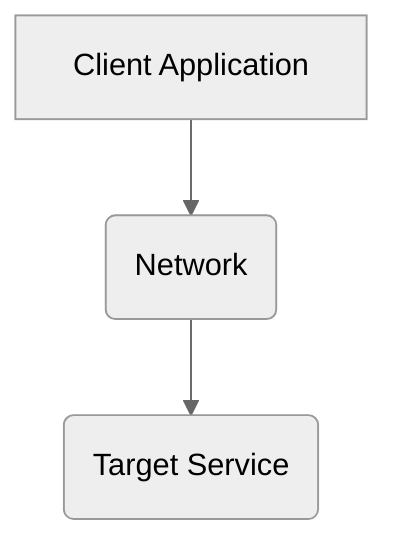
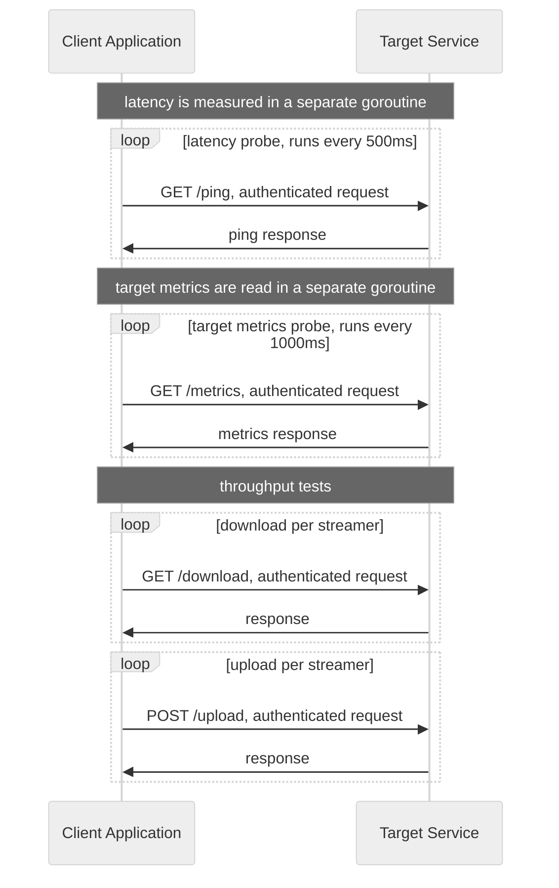

# Speed Test

Speed Test diagnoses network communication. It measures latency, throughput and other diagnostic data.

The project has two independent parts. The `target` service exposes a REST API that creates network load.
The `client` application runs load tests and collects diagnostic data.

**Result example:**

```text
   ____                      _   _____         _
  / ___| _ __   ___  ___  __| | |_   _|__  ___| |_
  \___ \| '_ \ / _ \/ _ \/ _' |   | |/ _ \/ __| __|
   ___) | |_) |  __/  __/ (_| |   | |  __/\__ \ |_
  |____/| .__/ \___|\___|\__,_|   |_|\___||___/\__|
        |_|

              target: http://target:8080
             streams: 10
 idle phase duration: 5s
   rx phase duration: 15s
   tx phase duration: 15s

              status: finished

        idle latency: min=0.480ms    avg=1.165ms    max=1.582ms
      loaded latency: min=0.248ms    avg=2.216ms    max=9.489ms
                  rx: 185.2GB    98.8Gbit/s
                  tx: 128.4GB    68.5Gbit/s
```

## Architecture



### Target service

The `target` service exposes REST API endpoints for creating network load and for diagnostics. All endpoints are behind
an authentication middleware. It checks the `X-Api-Key` header against the key set in the `API_KEY` environment
variable. The keys are compared with `subtle.ConstantTimeCompare`, so the response time does not reveal whether the key
is correct.

A goroutine collects current CPU and memory metrics. The metrics are available through the REST API.

The service runs in a Docker container.

**API**:

- `GET /ping` - simple handler that returns 204 (no content).
- `GET /metrics` - returns CPU and memory metrics as JSON.
- `GET /download` - returns an infinite stream of data.
- `POST /upload` - reads the data stream and discards it. When all data is received, it returns the number of received
  bytes.

### Client application

The `client` is a CLI application. It runs diagnostic tests against the `target` service.

Parameters:

- `idle-phase-duration` - how long the idle phase runs, in seconds
- `download-phase-duration` - how long the download phase runs, in seconds
- `upload-phase-duration` - how long the upload phase runs, in seconds
- `streams` - number of parallel goroutines in the download phase and in the upload phase
- `target` - URL of the `target` service

The client runs once in a Docker container and prints results to standard output.

**How it works:**

- the client starts in a one-off Docker container
- it sends a `ping` request to `target`; if it fails, the client stops
- it starts collecting statistics from the tests and probes and prints them to standard output using ANSI escape codes
- a goroutine measures latency
    - it sends a `ping` request to `target` every 500 ms
    - it computes min, avg and max; latency is tracked separately for the idle and loaded phases
- a goroutine reads metrics from `target` every 1000 ms, such as CPU and memory usage
- the client first runs an idle phase (`idle-phase-duration`) and measures idle latency
- a goroutine runs the load test
    - the test has two phases: download and upload
    - download: `streams` goroutines download data in parallel for `download-phase-duration`; the client waits until
      the phase ends
    - upload: `streams` goroutines upload data in parallel for `upload-phase-duration`; the client waits until the
      phase ends
    - in both phases the client counts sent and received data

**Sequence diagram:**



## Initialization & run tests

**Requirements:** Docker with Compose, `make`.

Start the target service:

```bash
make run-target
```

Run the client with default settings:

```bash
make run-client
```

| Make variable             | Client flag               | Default              |
|---------------------------|---------------------------|----------------------|
| `IDLE_PHASE_DURATION`     | `idle-phase-duration`     | `5`  (seconds)       |
| `DOWNLOAD_PHASE_DURATION` | `download-phase-duration` | `10` (seconds)       |
| `UPLOAD_PHASE_DURATION`   | `upload-phase-duration`   | `10` (seconds)       |
| `STREAMS`                 | `streams`                 | `10`                 |
| `TARGET`                  | `target`                  | `http://target:8080` |

Run the client with custom settings:

```bash
make run-client IDLE_PHASE_DURATION=0 DOWNLOAD_PHASE_DURATION=5 UPLOAD_PHASE_DURATION=5 STREAMS=3
```

Both services share the API key from the `API_KEY` environment variable (default `sp33dt3st`):

```bash
API_KEY=secret make run-target
API_KEY=secret make run-client
```

Stop all services:

```bash
make down
```

## Todo & Improvements

1. make decision: which endpoints need auth
1. implement CPU usage on client side
1. compute avg, min, max CPU usage
1. upload & download in same time (test full duplex)
1. upload throughput metrics should be computed in `target` service
