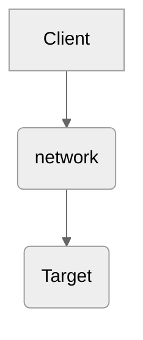
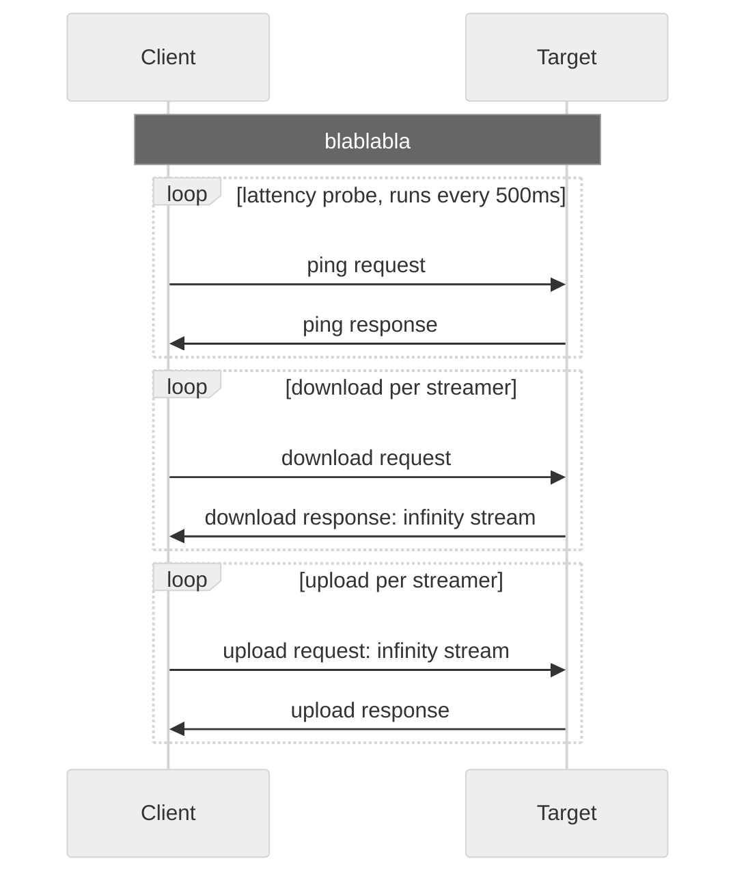

# Speed Test
Speed Test tools diagnostikují síťovou komunikaci. Měří latency, propustnost, ...

## Architecture
Jedná se o dvě nezávislé služby `client` a `target`.



### Client
Služba `client` je zodpovědná za pouštění diagnostických testů proti službě `target`.

### Target
Služba `target` vystavuje REST API. 

#### API


## Test sequence diagram



## Run tests
Runs target service:
```bash
make run-target
```

Runs test with default settings:
```bash
make run-client
```

Runs test with customized settings:
```bash
make run-client DURATION=1 STREAMS=3
```

## Todo & Improvements
1. make decision: which endpoints need auth 
1. compute min, max lattency
1. implement CPU usage on client side
1. compute avg, min, max CPU usage
